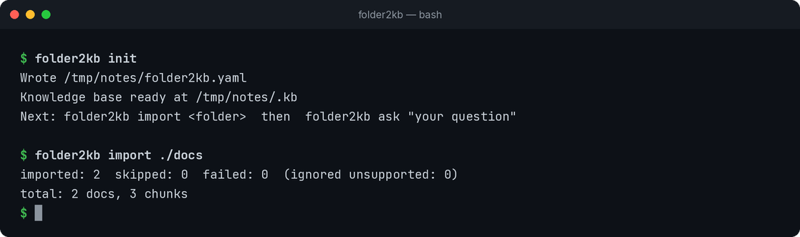
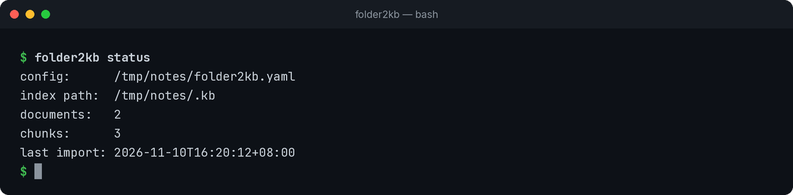
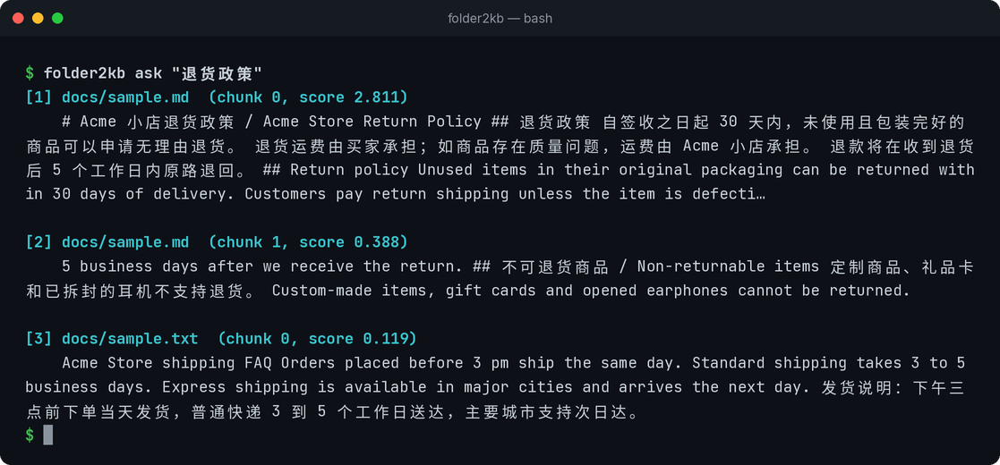
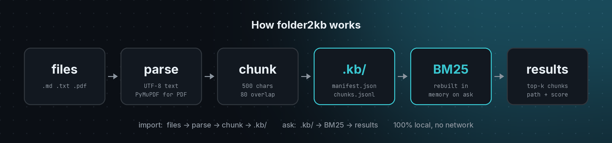

<p align="center">
  
</p>

<h1 align="center">folder2kb</h1>

<p align="center">
  <b>一条命令，把任意文档文件夹变成本地可检索的知识库。</b><br>
  对 Markdown、纯文本和 PDF 做离线 BM25 检索——支持中英文，无需 GPU，无需下载模型。
</p>

<p align="center">
  <a href="https://github.com/Xkongai/folder2kb/actions/workflows/ci.yml"></a>
  <a href="LICENSE"></a>
  
</p>

<p align="center">
  <a href="README.md">English</a> | <b>简体中文</b> | <a href="README.ja.md">日本語</a> | <a href="README.es.md">Español</a> | <a href="README.pt-BR.md">Português (Brasil)</a> | <a href="README.fr.md">Français</a> | <a href="README.de.md">Deutsch</a> | <a href="README.ko.md">한국어</a> | <a href="README.ru.md">Русский</a>
</p>

```bash
folder2kb import ~/notes
folder2kb ask "拆封商品能退货吗"
```

folder2kb 会遍历文件夹，从 Markdown、纯文本和 PDF 中提取文字，切分成片段，
然后让你在终端里用 BM25 检索——完全离线，支持中英文，无需 GPU，无需下载模型。

## 目录

- [为什么用 folder2kb？](#为什么用-folder2kb)
- [演示](#演示)
- [安装](#安装)
- [快速开始](#快速开始)
- [命令一览](#命令一览)
- [支持的格式](#支持的格式)
- [配置](#配置)
- [工作原理](#工作原理)
- [使用场景](#使用场景)
- [路线图与当前局限](#路线图与当前局限)
- [参与贡献](#参与贡献)
- [许可证](#许可证)

## 为什么用 folder2kb？

| | |
| --- | --- |
| 🔒 **离线优先** | 所有数据都存在配置文件旁边的 `.kb/` 目录里。不联网、不需要 API Key、没有遥测。 |
| 🀄 **开箱支持中英文** | 内置分词器处理拉丁单词和中日韩文字（单字 + 相邻双字），`退货政策` 这样的查询直接可用——不需要 jieba，不需要词典。 |
| 🪶 **小巧、安装快** | 不依赖 PyTorch、向量模型或向量数据库，只有四个小依赖。 |
| ♻️ **增量导入** | 再次运行 `import` 时，内容没变的文件（按 SHA-256 判断）会被跳过。 |
| 📄 **纯文件存储** | 索引就是可读的 `manifest.json` + `chunks.jsonl`，方便查看、备份，或接入你自己的 RAG 流程。 |

## 演示

下面的截图都是用 folder2kb 0.1.0 真实运行得到的输出，演示的导入命令是
`folder2kb import ./docs`。示例文件是虚构的「Acme 小店」退货政策（Markdown）和发货说明（纯文本），
与 [`tests/fixtures/`](tests/fixtures) 里的文档相同。

**1. 创建知识库并导入文件夹**



**2. 查看知识库里有什么**



**3. 用中文提问——`退货政策` 第一条就命中正确段落**



排在第一的是中英双语的退货政策段落（得分 2.811），后面是相关度更低的结果。
每条结果都会显示来源文件、片段编号和 BM25 得分。

## 安装

需要 **Python 3.11+**。

```bash
git clone https://github.com/Xkongai/folder2kb.git
cd folder2kb
python -m venv .venv
source .venv/bin/activate        # Windows: .venv\Scripts\activate
pip install -e .
```

验证安装：

```bash
folder2kb --version   # 0.1.0
```

## 快速开始

```bash
# 1. 在当前目录创建 folder2kb.yaml 和空的 .kb/
folder2kb init

# 2. 导入单个文件或整个文件夹（递归）
folder2kb import ./docs

# 3. 查看知识库状态
folder2kb status

# 4. 提问（中文或英文）
folder2kb ask "退货政策"
folder2kb ask "how long do refunds take" -k 3
```

输出示例：

```text
$ folder2kb import ./docs
imported: 2  skipped: 0  failed: 0  (ignored unsupported: 0)
total: 2 docs, 3 chunks

$ folder2kb ask "退货政策"
[1] docs/sample.md  (chunk 0, score 2.811)
    # Acme 小店退货政策 / Acme Store Return Policy ## 退货政策 自签收之日起 30 天内，未使用且包装完好的商品可以申请无理由退货。…
```

再运行一次 `import`，没有变化的文件会显示为 `skipped`（已跳过）。

## 命令一览

| 命令 | 作用 |
| --- | --- |
| `folder2kb init [--force]` | 创建 `folder2kb.yaml` 和 `.kb/`（已有配置时不会覆盖，除非加 `--force`）。 |
| `folder2kb import <路径> [-v]` | 递归导入文件或文件夹，输出导入 / 跳过 / 失败的数量。`-v` 会列出每个文件。 |
| `folder2kb status` | 显示文档数、片段数、索引路径和最近一次导入时间。 |
| `folder2kb ask "<问题>" [-k N] [--width N]` | 输出最相关的 top-k 个片段，附来源路径和得分。`--width` 限制每个片段显示的字符数（默认 300，`0` 为完整显示）。 |
| `folder2kb version` / `--version` | 显示版本号。 |

退出码：

| 退出码 | 含义 |
| --- | --- |
| `0` | 成功 |
| `1` | 出错（配置有误、知识库无法读取、路径不存在，或本次导入的文件全部失败） |
| `2` | 知识库为空时运行 `ask`——请先运行 `folder2kb import` |
| `3` | `ask` 没有找到匹配的片段 |

## 支持的格式

| 扩展名 | 解析方式 |
| --- | --- |
| `.md`、`.markdown` | 按 UTF-8 读取（无效字节会被替换） |
| `.txt` | 按 UTF-8 读取（无效字节会被替换） |
| `.pdf` | 用 [PyMuPDF](https://pymupdf.readthedocs.io/) 提取文字（不做 OCR） |

其他文件会被标记为“unsupported, ignored”并跳过。隐藏文件和文件夹
（`.git`、`.venv`、`node_modules`、`.kb/` 知识库本身等）永远不会被导入。

## 配置

`folder2kb init` 会生成 `folder2kb.yaml`（参见 [`folder2kb.yaml.example`](folder2kb.yaml.example)）：

```yaml
kb_dir: .kb          # 知识库存放位置（相对于本文件）
chunk_size: 500      # 每个片段的最大字符数
chunk_overlap: 80    # 相邻片段之间重叠的字符数
top_k: 5             # ask 默认返回的结果数
```

| 字段 | 默认值 | 说明 |
| --- | --- | --- |
| `kb_dir` | `.kb` | 知识库存放位置，相对于 `folder2kb.yaml`。 |
| `chunk_size` | `500` | 每个片段的最大字符数。 |
| `chunk_overlap` | `80` | 相邻片段之间重叠的字符数。 |
| `top_k` | `5` | `ask` 默认返回的结果数（可用 `-k` 覆盖）。 |

folder2kb 会在当前目录及其上级目录中查找 `folder2kb.yaml`，所以在项目的任意子目录里都能运行命令。
找不到配置文件时使用默认值。

## 工作原理



```text
文件 ──► 解析 ──► 切分 ──► .kb/（manifest.json + chunks.jsonl）──► BM25 ──► top-k 结果
```

1. **解析** —— `.md`/`.txt` 按 UTF-8 读取；`.pdf` 用 PyMuPDF 逐页提取文字。
2. **切分** —— 递归字符切分器依次按段落、换行、句末标点（中英文）、空格切分，每个片段不超过 `chunk_size` 个字符，并保留 `chunk_overlap` 个字符的上下文。
3. **存储** —— 文档元数据（路径、SHA-256、修改时间、大小、片段数）写入 `manifest.json`；片段写入 `chunks.jsonl`。写入是原子操作。
4. **检索** —— 每次 `ask` 时，从已存储的片段在内存中重建 BM25 索引（[rank-bm25](https://github.com/dorianbrown/rank_bm25)），文档和查询使用同一个分词器。

## 使用场景

- **个人笔记。** 指向 Obsidian 笔记库或一个 Markdown 笔记文件夹，在终端里直接搜索，不用上传任何东西。
  ```bash
  cd ~/notes && folder2kb init && folder2kb import .
  folder2kb ask "docker compose healthcheck"
  ```
- **团队手册和常见问题。** 把制度、SOP、客服话术（就像 Acme 示例那样）放进一个文件夹建索引，在中英混排的文字里快速找到相关段落。
  ```bash
  folder2kb import ./handbook
  folder2kb ask "发票怎么开" -k 3
  ```
- **离线 RAG 预处理。** 把 folder2kb 当成一层简单的检索：片段就存放在普通的 `chunks.jsonl` 里，可以用你自己的脚本读取，也可以把 `ask` 返回的 top-k 结果交给你正在用的大模型。
  ```bash
  folder2kb ask "refund timeline" -k 5 --width 0 > context.txt
  ```

## 路线图与当前局限

路线图：

- [ ] 更多格式：`.docx`、`.html`
- [ ] `folder2kb watch` —— 文件变化时自动增量导入
- [ ] 清理已从磁盘删除的文档
- [ ] 可选：通过任意 OpenAI 兼容 API 生成向量（BM25 + 向量混合检索）
- [ ] 可选：基于检索结果与本地大模型对话（如 Ollama）
- [ ] 便于脚本调用的 JSON 输出（`ask --json`）

当前局限：

- **不做 OCR** —— 没有文字层的扫描版 PDF 无法检索。
- **暂不支持 `.docx` / `.html`** —— 请先转换成 Markdown 或纯文本。
- **已删除的文件不会自动清理** —— 从磁盘删掉文件后，索引里暂时还会保留。
- **`ask` 每次都在内存中重建 BM25。** 对个人和团队规模的文档足够快，但不适合上百万个片段的场景。
- **关键词检索，不是语义检索** —— BM25 按词和字匹配，没有共同字词的同义表达无法命中。

暂不考虑：网页界面、多用户、云同步、网页爬取。

## 参与贡献

欢迎提交 Issue 和 Pull Request！开发环境搭建和测试方法（`pytest -q`）请见 [CONTRIBUTING.md](CONTRIBUTING.md)。

## 许可证

[MIT](LICENSE) © 2026 Xkongai
